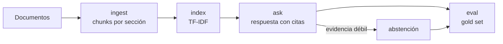
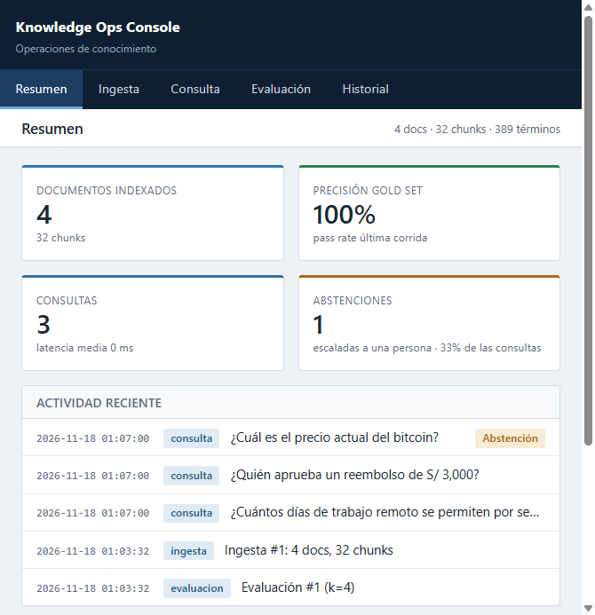

# knowledge-ops-console

Ingesta, índice léxico, respuestas con citas y evaluación contra un gold set en una consola local.


Autor: **Angel Salazar Lima** · CIP 404730

---

## Problema

Los SOPs y políticas viven en carpetas sueltas. Cuando un asistente responde sobre ellos, nadie sabe de qué documento salió la respuesta ni si el asistente es confiable. Una respuesta sin fuente es un riesgo operativo; una abstención a tiempo, no.

## Hipótesis

Un pipeline léxico y determinista (TF-IDF + cobertura ponderada por idf) basta para responder con cita correcta sobre un corpus acotado y para abstenerse cuando la evidencia es débil, sin APIs externas ni modelos neuronales.

| # | Hipótesis | Criterio |
|---|---|---|
| H1 | El documento correcto está en el top-4 | recall@4 ≥ 0.90 |
| H2 | La respuesta cita el documento esperado | citation hit ≥ 0.90 |
| H3 | Sin evidencia, el sistema se abstiene | abstención correcta = 100 %, falsa respuesta = 0 % |
| H4 | El umbral de cobertura 0.45 no genera falsas abstenciones | falsa abstención = 0 % en el gold |

## Métricas

Gold set de 13 casos (11 respondibles, 2 sin evidencia) sobre 4 documentos / 32 chunks. Snapshot en [`results/eval.md`](results/eval.md).

| Métrica | Resultado |
|---|---|
| recall@4 | 100 % |
| citation hit | 100 % |
| keyword score | 100 % |
| abstención correcta | 100 % |
| falsa abstención / falsa respuesta | 0 % / 0 % |
| pass rate | 100 % (13/13) |

El 100 % es sobre un corpus pequeño y sintético. El sondeo adversarial muestra que un umbral de cobertura de 0.30 dejaría pasar 3 de 6 preguntas engañosas, algo que el gold por sí solo no detecta. Detalle y límites en [EXPERIMENT.md](docs/EXPERIMENT.md) y [CONCLUSIONS.md](docs/CONCLUSIONS.md).

## Flujo



Arquitectura completa y referencia de despliegue en AWS: [docs/architecture.md](docs/architecture.md).

| Comando | Qué hace | Salida |
|---|---|---|
| `ingest <dir>` | Lee `.txt`/`.md`, divide por secciones numeradas y chunks de ≤ 90 palabras | `data/index.json` + SQLite |
| `ask "<pregunta>"` | TF-IDF coseno + cobertura idf; oraciones extractivas | Respuesta, citas `[n]`, confianza |
| `eval` | recall@k, citation hit, keywords y abstención | `results/eval.md` + `.json` |
| `status` | Estado del índice, consultas y evaluaciones | Consola |
| `serve` | Consola web | Puerto 8020 |

La abstención se activa si la cobertura es < 0.45 o la confianza < 0.40.

## Consola web

Panel sobrio con barra lateral: **Resumen** (KPIs de documentos indexados, precisión del gold set, consultas y abstenciones, más actividad reciente), **Ingesta**, **Consulta**, **Evaluación** e **Historial**.



Bootstrap se carga desde CDN; el backend y los datos funcionan sin conexión.

## Uso local

```bash
python -m venv .venv
.venv\Scripts\activate          # Linux/macOS: source .venv/bin/activate
pip install -e ".[dev]"
pytest

python -m knowledge_ops ingest samples/docs
python -m knowledge_ops ask "¿Cuántos días tiene un cliente para pedir el reembolso total?"
python -m knowledge_ops eval
python -m knowledge_ops serve
```

URL: http://127.0.0.1:8020 · También disponible como `knowledge-ops <comando>`. El directorio de trabajo (`data/`, `results/`) es el actual, o `--home` / `KNOPS_HOME`.

## Docker

```bash
docker compose up --build
```

Sirve en http://localhost:8020. Al arrancar ingesta `samples/docs`; `data/` y `results/` van en volúmenes.
## CI

[`.github/workflows/ci.yml`](.github/workflows/ci.yml): `pytest` en Python 3.10 y 3.12, evaluación del gold set (el job falla si `pass_rate` < 100 %, publica `eval.md` en el resumen y como artefacto) y build de la imagen Docker. La evaluación puede omitirse al lanzar el workflow a mano.

## Estructura

```
src/knowledge_ops/
  ingest.py       lectura y chunking por sección
  index.py        tokenizador, stemming ligero, TF-IDF, persistencia JSON
  retrieve.py     búsqueda y cobertura
  answer.py       respuesta extractiva, citas, umbrales de abstención
  eval_runner.py  gold set y métricas
  store.py        SQLite: ingestas, consultas, evaluaciones, KPIs
  service.py      casos de uso compartidos
  web.py          FastAPI + templates/index.html
samples/docs/     4 documentos SOP/políticas
samples/gold/     questions.jsonl (13 casos, 2 de abstención)
docs/             architecture, EXPERIMENT, CONCLUSIONS
results/          snapshot de eval.md y eval.json
```

Formato del gold: `id`, `question`, `expected_doc`, `expected_keywords`, `should_abstain` (opcional; por defecto si `expected_doc` es `null`).

## Ecosistema

| Repo | Relación |
|---|---|
| [rag-eval-platform](https://github.com/Angelzaki/rag-eval-platform) | Evaluación local de sistemas RAG: chunking, retrieval, faithfulness, citas y abstención |
| [prompt-firewall](https://github.com/Angelzaki/prompt-firewall) | Firewall local de prompts, previo a `ask` |
| [abstention-lab-local](https://github.com/Angelzaki/abstention-lab-local) | Calibración de abstención (`min_score × min_overlap`) |
| [citation-auditor-local](https://github.com/Angelzaki/citation-auditor-local) | Auditor de citas RAG: ¿existen y soportan la respuesta? |
| [chunk-lab](https://github.com/Angelzaki/chunk-lab) | Chunking fijo, por párrafo y por oración frente a retrieval |
| [retrieval-tuner-local](https://github.com/Angelzaki/retrieval-tuner-local) | Grid search de `top_k × min_score` |
| [eval-hub-local](https://github.com/Angelzaki/eval-hub-local) | Dashboard local que consolida los `results/` de los labs |
| [llm-ci-gates](https://github.com/Angelzaki/llm-ci-gates) | Quality gates para IA en CI |

---

Hecho en Lima · Angel Salazar Lima · CIP 404730
