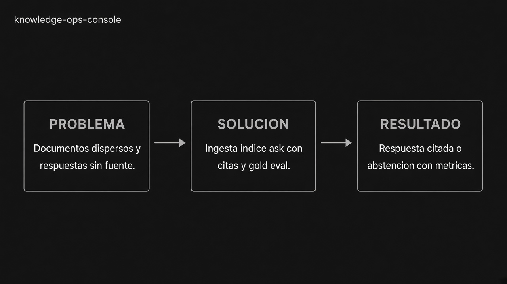
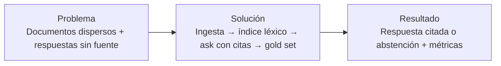

<div align="center">

# knowledge-ops-console

**Ingesta, índice, respuestas con citas y evaluación en una sola consola local** · Angel Salazar

<br/>


</div>

---

### `$ cat diagrama.md`



---

### `$ cat problema.md`

Los SOPs viven en carpetas sueltas y nadie sabe si el asistente responde bien.  
Una respuesta sin fuente es un riesgo; una abstención a tiempo, no.  
Esta consola indexa documentos locales, responde con citas, se abstiene si la evidencia es débil y mide todo contra un gold set.

---

### `$ cat flujo.md`

| Etapa | Qué hace | Salida |
|---|---|---|
| `ingest` | Lee `.txt`/`.md`, divide por secciones numeradas y chunks de ≤ 90 palabras | `data/index.json` + SQLite |
| `ask` | TF-IDF coseno + cobertura ponderada por idf; oraciones extractivas | Respuesta, citas `[n]`, confianza |
| abstención | Se activa si cobertura < 0.45 o confianza < 0.40 | "Escale a una persona" |
| `eval` | recall@k, citation hit, keywords y abstención correcta | `results/eval.md` + `.json` |
| `serve` | UI Bootstrap: ingesta, preguntar, evaluación, historial | Puerto 8020 |

Sin APIs externas ni modelos neuronales: recuperación léxica determinista, mismo input → mismo resultado.

---

### `$ cat estructura.md`

```
src/knowledge_ops/
  ingest.py       lectura y chunking por sección
  index.py        tokenizador, stemming ligero, TF-IDF, persistencia JSON
  retrieve.py     búsqueda y cobertura
  answer.py       respuesta extractiva, citas, umbrales de abstención
  eval_runner.py  gold set y métricas
  store.py        SQLite: ingestas, consultas, evaluaciones
  web.py          FastAPI + templates/index.html
samples/docs/     4 documentos SOP/políticas
samples/gold/     questions.jsonl (13 casos, 2 de abstención)
```

Formato del gold (`questions.jsonl`): `id`, `question`, `expected_doc`, `expected_keywords`, `should_abstain` (opcional; por defecto si `expected_doc` es `null`).

---

```bash
python -m venv .venv
.venv\Scripts\activate          # Linux/macOS: source .venv/bin/activate
pip install -e ".[dev]"
pytest

python -m knowledge_ops ingest samples/docs
python -m knowledge_ops ask "¿Cuántos días tiene un cliente para pedir el reembolso total?"
python -m knowledge_ops eval
python -m knowledge_ops status
python -m knowledge_ops serve
```

También disponible como `knowledge-ops <comando>`. El directorio de trabajo (`data/`, `results/`) es el actual, o `--home` / `KNOPS_HOME`.

UI Bootstrap: http://127.0.0.1:8020

> La UI carga Bootstrap desde CDN; el backend y los datos funcionan 100% offline.

---

Hecho en Lima · Angel Salazar · CIP 404730
