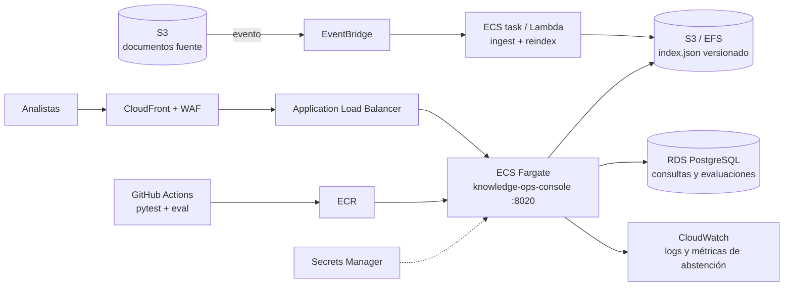

# Arquitectura

Autor: Angel Salazar Lima · CIP 404730

Knowledge Ops Console es un pipeline determinista de cuatro etapas: **ingest → index → ask → eval**. Todo corre en un solo proceso Python, sin APIs externas ni modelos neuronales. El estado vive en `data/` (índice JSON y SQLite) y los reportes en `results/`.

## Flujo de datos

```mermaid
flowchart LR
  subgraph IN[Ingest]
    D[Documentos .txt / .md] --> L[Lectura utf-8 / cp1252]
    L --> B[Bloques por encabezado numerado]
    B --> C[Chunks ≤ 90 palabras]
  end
  subgraph IX[Index]
    C --> T[Tokenizador<br/>sin acentos, stopwords, stemming ligero]
    T --> TF[TF por chunk + IDF global]
    TF --> J[(data/index.json)]
  end
  subgraph AK[Ask]
    Q[Pregunta] --> R[Búsqueda TF-IDF coseno<br/>+ cobertura ponderada por idf]
    J --> R
    R --> G{cobertura ≥ 0.45<br/>y confianza ≥ 0.40}
    G -- sí --> A[Oraciones extractivas<br/>+ citas n]
    G -- no --> X[Abstención<br/>escalar a una persona]
  end
  subgraph EV[Eval]
    GS[(gold set JSONL)] --> E[recall@k · citation hit<br/>keywords · abstención]
    A --> E
    X --> E
    E --> RP[results/eval.md + eval.json]
  end
  A --> S[(SQLite<br/>ingestas · consultas · evaluaciones)]
  X --> S
  E --> S
  S --> UI[Consola web :8020<br/>KPIs · actividad · historial]
```

## Componentes

| Módulo | Responsabilidad |
|---|---|
| `ingest.py` | Lectura robusta de archivos, hash SHA-256, división por secciones y chunking |
| `index.py` | Normalización léxica, TF-IDF, persistencia versionada del índice |
| `retrieve.py` | Ranking por coseno y cobertura idf de los términos de la consulta |
| `answer.py` | Selección de oraciones, citas, confianza y reglas de abstención |
| `eval_runner.py` | Carga del gold set, métricas y reporte Markdown |
| `store.py` | SQLite: ingestas, documentos, consultas, evaluaciones, KPIs y actividad |
| `service.py` | Casos de uso compartidos por CLI y API |
| `web.py` | API FastAPI y consola HTML |

## Regla de abstención

1. Sin términos coincidentes → abstención.
2. `cobertura(top) < 0.45` → abstención. La cobertura es la fracción del peso idf de la consulta presente en el chunk principal.
3. `confianza < 0.40` → abstención. Confianza = 0.65·cobertura + 0.25·fuerza + 0.10·margen sobre el segundo resultado.
4. Si ninguna oración del chunk solapa con la consulta → abstención.

La respuesta nunca contiene texto que no esté en un chunk citado.

## Superficie HTTP

| Método | Ruta | Uso |
|---|---|---|
| GET | `/api/status` | Índice, contadores, KPIs y actividad reciente |
| POST | `/api/ingest` | Ingesta de un directorio |
| POST | `/api/ask` | Pregunta con citas |
| POST | `/api/eval` | Evaluación contra gold set |
| GET | `/api/eval/latest` | Última evaluación e historial |
| GET | `/api/history` | Consultas registradas |

## Referencia de despliegue en AWS

Diseño de referencia para llevar el mismo pipeline a producción. **No está implementado en este repositorio y no contiene credenciales**; el código actual solo requiere disco local.



Decisiones de referencia:

- **Contenedor:** la imagen del `Dockerfile` se publica en ECR y corre en Fargate detrás de un ALB; el health check usa `GET /api/status`.
- **Fuente de verdad:** S3 versionado para documentos; el reindexado se dispara por evento y publica un `index.json` nuevo, con rollback por versión.
- **Estado:** SQLite se sustituye por PostgreSQL cuando haya más de una réplica; el esquema ya separa ingestas, documentos, consultas y evaluaciones.
- **Gate de calidad:** el workflow de CI ejecuta `eval` y bloquea el despliegue si `pass_rate` cae por debajo del umbral acordado.
- **Observabilidad:** la tasa de abstención y la latencia por consulta se exportan a CloudWatch; un salto de abstenciones indica deriva de documentos o de consultas.
- **Seguridad:** acceso por rol IAM de la tarea; sin claves en la imagen. Cualquier credencial futura va en Secrets Manager. Para filtrar entradas hostiles antes de `ask` ver [prompt-firewall](https://github.com/Angelzaki/prompt-firewall).

## Límites conocidos

- Recuperación solo léxica: no resuelve sinónimos ni paráfrasis lejanas.
- Respuesta extractiva: no sintetiza entre varios documentos más allá de una segunda cita.
- Chunking basado en encabezados numerados `N. Título`; sin ellos el documento se divide solo por párrafos y longitud, sin sección en las citas.
- Índice completo en memoria: adecuado para cientos de documentos, no para millones.
